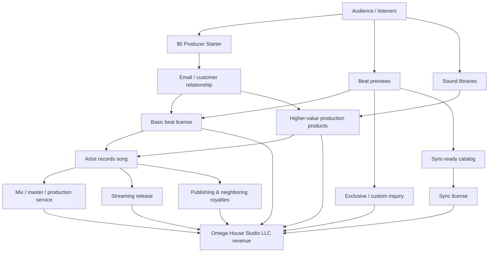

# Predictable Outcomes for Omega House Beats and Business Effects on Omega House Studio LLC

**Approval:** Locked by Daniel Webster Sutton (Danny Bourdain), October 21, 2026.
**Owner:** Omega House Studio LLC. **Domain:** Omega House Beats commercial planning.
**Status:** Approved planning baseline, not an audited forecast, guarantee, valuation, or runtime implementation.
**Source:** User-supplied research pasted on October 21, 2026. The supplied text ends at the partial sensitivity-table row `| Subscription`. No missing continuation has been invented.
**Evidence boundary:** The original research citation tokens below are preserved as source labels only. Their underlying URLs were not supplied in this conversation and have not been independently verified in this adoption. Approval applies to the planning direction, not independent certification of source claims. Current Shopify actuals and rights evidence must supersede assumptions when verified.
**Sonic boundary:** Repository knowledge adoption only; no automatic runtime ingestion, live Shopify connection, subscription launch, spend authorization, or automated financial decision is implemented by this document.

## Locked operating decision

Omega House Beats is the scalable intellectual-property and customer-acquisition layer of Omega House Studio LLC. The LLC remains the contracting, banking, accounting, rights-holding, service-delivery and liability-management entity. Prioritize controlled-catalog direct commerce: repeat non-exclusive beat licenses, packs/tools and suitable service conversion. Treat streaming and sync as variable upside. Subscriptions are proposed, not an existing or approved-to-launch product. Use the base scenario as the management target, the conservative case as a stress-planning reference, and the aggressive case as an organizational expansion scenario. These scenarios do not supersede the approved BFCM offer and pricing decisions.

---

## Executive summary

As of October 21, 2026, **Omega House Beats is already structured more like a small digital music-rights business than a conventional recording studio website**. Its public storefront sells original beats, sound libraries, production tools, licenses, and an entry-level $5 Producer Starter; the official About page explicitly identifies Omega House Beats as the production catalog created through Omega House Studio LLC by Danny Bourdain. The storefront currently presents beat licenses beginning around $30–$35, sound libraries around $20–$45, a production suite at $80, and service extensions such as a $25 five-stem mix/master. [Source labels: turn16view0, turn16view1, turn16view3, turn16view4]

The central conclusion of this research is that **the most predictable revenue for Omega House Studio LLC does not come from Spotify streams or sync placements. It comes from direct commerce around a controlled catalog**: repeated non-exclusive beat licenses, digital production products, service conversion, and—if introduced carefully—recurring subscriptions. Sync and streaming are valuable portfolio components, but they should be modeled as upside and diversification rather than as the economic foundation. Spotify itself states that there is no fixed per-stream royalty rate; payments depend on streamshare and rights-holder arrangements, while sync transactions are individually negotiated rights transactions. [Source labels: turn17view14, turn17view15, turn15search3]

There is an important limitation: **no audited revenue history, verified unit-sales history, customer count, traffic data, advertising history, or complete catalog-rights ledger is publicly available**. Therefore, a statistically fitted forecast is impossible from public evidence. The appropriate rigorous method is a **driver-based forecast**: transactions × realized price, subscribers × monthly recurring revenue, licensing deals × deal value, placements × attributable sync fee, and actual rights-holder receipts for streaming and royalties.

Under that framework, the modeled annual gross-revenue outcomes are:

| Scenario | Year-one annual revenue | Year-three annual revenue | Year-five annual revenue | Approx. five-year cumulative revenue* |
|---|---:|---:|---:|---:|
| Conservative | **$8,800** | **$24,450** | **$45,500** | **$126,800** |
| Base | **$33,500** | **$119,600** | **$272,600** | **$669,600** |
| Aggressive | **$117,500** | **$472,000** | **$1,161,000** | **$2.73 million** |

*Five-year cumulative revenue uses geometric interpolation for years two and four between the explicitly modeled years one, three, and five. These are gross receipts scenarios, not valuations, profits, or guarantees.

The **base case is the most useful management target**. It does not require a viral record, major-label placement, or blockbuster sync. By year one it requires approximately 300 standard beat-license transactions, four higher-value exclusive/custom licenses, a modest subscriber base averaging 25 paid members, one modeled sync placement, modest streaming/royalty receipts, and $6,000 of studio-service revenue attributable to the Beats funnel. By year five, the base case reaches $272,600 in annual gross revenue, with less than half dependent on any single revenue source.

The aggressive case is economically possible but is **not a reasonable passive extrapolation of the existing storefront**. Reaching approximately $1.16 million annual revenue by year five would require a genuine operating company: roughly 5,000 annual beat licenses, about 1,200 average paid subscribers, approximately 60 premium licensing transactions, approximately 12 attributable sync placements, materially larger streaming reach, a roughly 300-item active commercial catalog, and specialist capacity in marketing, rights administration, content operations, customer support, and accounting. It is therefore an organizational scenario, not merely a marketing scenario.

The larger music market is supportive rather than sufficient. U.S. recorded-music wholesale revenue reached roughly $5.97 billion in the first half of 2026, up 6.9% year over year; streaming represented approximately $4.89 billion, while synchronization revenue reached about $231.8 million, up 18.2%. Globally, recorded-music revenue reached $31.7 billion in 2025, with streaming representing 69.6% of recorded-music revenue. [Source labels: turn18view0, turn18view4] These trends expand the addressable economic environment, but they do **not** automatically create demand for an individual producer catalog. Discovery, brand differentiation, conversion, catalog depth, price architecture, repeat purchasing, and rights cleanliness remain the causal bottlenecks.

For Omega House Studio LLC, the strategic implication is straightforward:

> **Omega House Beats should function as the scalable intellectual-property and customer-acquisition layer of Omega House Studio LLC, while the LLC remains the contracting, banking, accounting, rights-holding, service-delivery, and liability-management entity.**

At the conservative level, Omega House Beats is primarily a founder-operated catalog. At the base level, it becomes a meaningful recurring commercial asset. At the aggressive level, the catalog and associated licensing rights become the principal operating system of the company, requiring professional rights administration and multi-person execution.

## Public profile and evidentiary baseline

### What can be established publicly

Omega House's official website identifies the business publicly as **“OMEGA HOUSEBEATS / ST. LOUIS”** and markets original beats, cinematic sound libraries, production tools, digital downloads, and product-specific licenses. The site's stated sonic positioning is cinematic hip-hop, trap, and soul. [Source label: turn16view0]

The company's About page states that **Omega House Beats is the production catalog and sonic world created through Omega House Studio LLC by Danny Bourdain** and describes the catalog as serving artists and producers. It identifies Flagship Beats as the premium production direction and the $5 Producer Starter as a low-friction entry product. [Source label: turn16view1]

The storefront therefore has an observable funnel already:

The current public pricing architecture is materially useful for forecasting. The homepage shows several original beats starting at $30–$35; sound libraries around $20–$35; a production suite at $80; and a $19 production playbook. The Signature Edition page lists a $45 product and links to a $25 five-stem mix/master service. [Source labels: turn16view0, turn16view4]

The $5 Producer Starter is explicitly a one-time digital product that includes a Basic License and currently advertises eligibility for the first 500 qualifying MVP Founder positions. [Source label: turn16view3] This is strategically important because it gives Omega House an existing low-priced customer-acquisition product rather than requiring every first purchase to occur at the $30-plus beat-license level.

Omega House's licensing page already distinguishes a **non-exclusive Basic License** from an **Exclusive License**. A Basic license leaves the beat available for additional licensing; when an Exclusive License is purchased, Omega House states that the beat is retired from future licensing. [Source label: turn16view2] That architecture is consistent with common online beat-marketplace mechanics: BeatStars permits repeated non-exclusive licensing while removing an exclusive beat from future availability. [Source label: turn18view7]

Omega House's Signature products also state that source assets remain licensed content rather than becoming purchaser-owned intellectual property. [Source label: turn16view4] That distinction is commercially valuable because it preserves the reusable IP layer instead of unintentionally converting every sample-pack sale into an assignment.

A public Shop profile exposes at least 22 product/service listings, including beats, sample products, production suites, custom production, mix/master work, and other production assets. That count is a **commercial SKU count, not a count of distinct copyrighted compositions or masters**. [Source label: turn16view5]

A secondary public business profile identifies “Omega House Studio LLC,” associates it with Daniel Sutton, and locates it in Saint Louis, Missouri. [Source label: turn16view6] I did **not**, however, retrieve an indexed Missouri Secretary of State entity-detail page establishing the exact charter number, formation date, registered agent, management designation, or current good-standing status. The Missouri Secretary of State provides official business-filing/search services, but the exact entity record did not surface through the indexed public-web searches performed for this report. Accordingly, those details are **not assumed to be verified**. Missouri's own guidance confirms that an LLC is formed by Articles of Organization and requires an operating agreement; Missouri LLCs do not file annual reports. [Source labels: turn16view9, turn16view10]

Likewise, the Copyright Office maintains the official Copyright Public Records System for records from 1978 forward. [Source labels: turn16view7, turn16view8, turn22view0] Searches performed for this report did not produce a reliable indexed result proving registration of the Omega House catalog under “Omega House,” “Omega House Beats,” Danny Bourdain, or Daniel Sutton. **That is not evidence that registrations do not exist**; search-engine indexing of the copyright database is not equivalent to a direct title-by-title CPRS audit.

### Explicit forecasting assumptions

Because the requested inputs were not publicly disclosed, the financial model uses the following assumptions.

| Variable | Publicly verified | Modeling assumption |
|---|---|---|
| Current annual revenue | No reliable public revenue figure located | **Unknown; forecast starts from unit economics rather than percentage growth from existing revenue** |
| Starting catalog | At least 22 public product/service listings visible on Shop; storefront contains multiple distinct beats/libraries [turn16view0, turn16view5] | Approximately **22 active commercial SKUs/products** as the starting sales surface; underlying copyright count remains unknown |
| Current team | Public pages identify Danny Bourdain as creator; no reliable employee count located [turn16view1] | **One founder/operator plus contractors as needed** |
| Geographic market | Public positioning says St. Louis; site is online commerce [turn16view0] | **U.S.-led/global online**, planning assumption of roughly 80% U.S. / 20% non-U.S. demand initially |
| Current marketing spend | Not publicly disclosed | No existing paid-acquisition performance assumed |
| Rights ownership | Store represents Omega House material as licensed content, but complete chain of title is not publicly auditable [turn16view4] | Forecast assumes Omega House has sufficient rights to sell each modeled license; collaborator shares must be deducted where applicable |
| Forecast currency | — | Nominal U.S. dollars; no inflation escalation |
| Revenue basis | — | Gross receipts before taxes, payment/platform charges, refunds, contractor payouts, owner compensation and income taxes |
| Forecast period | — | Year one: roughly Nov. 2026–Oct. 2027; year three: year ending Oct. 2029; year five: year ending Oct. 2031 |

The absence of verified historical conversion and retention data matters. Until at least six to twelve months of cohort data exists, the ranges below should be understood as **planning scenarios with explicit causal assumptions**, not confidence intervals.

## Forecast model and predictable outcomes

### Revenue scenarios by channel

Amounts below are annual gross revenue in thousands of dollars.

| Scenario / horizon | Beat licenses | Packs & tools | Exclusive / custom licensing | Subscriptions | Streaming master income | Sync fees | Publishing & neighboring royalties | Studio-service conversion | **Total** |
|---|---:|---:|---:|---:|---:|---:|---:|---:|---:|
| Conservative Y1 | $3.60k | $2.40k | $0.50k | $0 | $0.60k | $0 | $0.20k | $1.50k | **$8.80k** |
| Conservative Y3 | 8.40 | 6.00 | 1.40 | 1.80 | 1.80 | 0.75 | 0.70 | 3.60 | **24.45** |
| Conservative Y5 | 15.60 | 11.20 | 2.70 | 3.60 | 3.50 | 1.50 | 1.40 | 6.00 | **45.50** |
| Base Y1 | $10.50k | $6.00k | $2.00k | $3.60k | $2.50k | $2.00k | $0.90k | $6.00k | **$33.50k** |
| Base Y3 | 34.00 | 20.00 | 7.00 | 21.60 | 10.00 | 8.00 | 4.00 | 15.00 | **119.60** |
| Base Y5 | 72.00 | 40.00 | 18.00 | 57.60 | 25.00 | 20.00 | 10.00 | 30.00 | **272.60** |
| Aggressive Y1 | $30.00k | $20.00k | $9.00k | $22.50k | $8.00k | $10.00k | $3.00k | $15.00k | **$117.50k** |
| Aggressive Y3 | 120.00 | 80.00 | 36.00 | 90.00 | 40.00 | 45.00 | 16.00 | 45.00 | **472.00** |
| Aggressive Y5 | 300.00 | 180.00 | 90.00 | 216.00 | 120.00 | 120.00 | 45.00 | 90.00 | **1,161.00** |

The structure deliberately separates **beat sales** from **licensing deals**. Beat sales are repeatable non-exclusive transactions. “Exclusive/custom licensing” represents negotiated high-value rights. That distinction matters because a non-exclusive beat remains monetizable after each transaction, whereas an exclusive sale removes at least part of its future licensing opportunity under Omega House's current policy. [Source labels: turn16view2, turn18view7]

“Subscriptions” are a **forecasted product, not a representation that Omega House currently sells a recurring membership**. For financial durability, the modeled subscription should primarily deliver recurring production resources, discounts, access, education/community benefits, and/or periodic assets rather than blanket commercial rights to the entire beat catalog. Giving unlimited commercial beat rights for one low monthly fee would materially cannibalize the higher-value licensing business.

“Streaming master income” refers to receipts attributable to Omega House-controlled masters, not a fixed per-stream calculation. Spotify explicitly states that streaming services do not pay a universal fixed rate per play and that Spotify pays rights holders according to streamshare. Spotify reports that an artist representing roughly one-millionth of all Spotify streams generated about $11,000 on Spotify in 2025, but that should be treated only as a scale reference—not as a royalty rate that can be multiplied by streams. [Source labels: turn17view14, turn17view15]

### Transaction assumptions behind the scenarios

The direct beat-license model is particularly transparent:

$$\text{Beat Revenue}=\text{Paid Beat Licenses}\times\text{Realized Average License Value}$$

| Scenario | Year-one beat sales | Year-three beat sales | Year-five beat sales |
|---|---:|---:|---:|
| Conservative | 120 × $30 = **$3,600** | 240 × $35 = **$8,400** | 390 × $40 = **$15,600** |
| Base | 300 × $35 = **$10,500** | 800 × $42.50 = **$34,000** | 1,440 × $50 = **$72,000** |
| Aggressive | 750 × $40 = **$30,000** | 2,400 × $50 = **$120,000** | 5,000 × $60 = **$300,000** |

The year-one conservative and base realized prices are anchored reasonably close to current public $30–$35 starting beat-license prices. Higher long-horizon prices assume that Omega House develops differentiated tiers, stronger social proof, larger file packages, higher-value rights, and better customer segmentation. Current product pricing establishes that the business already sells across multiple price points rather than at a single commodity price. [Source label: turn16view0]

Higher-value negotiated licenses are modeled as follows:

| Scenario | Year one | Year three | Year five |
|---|---|---|---|
| Conservative | 2 deals × $250 | 4 × $350 | 6 × $450 |
| Base | 4 deals × $500 | 10 × $700 | 20 × $900 |
| Aggressive | 10 deals × $900 | 30 × $1,200 | 60 × $1,500 |

These figures are **planning assumptions, not claimed industry averages**. Actual license value can differ radically depending on term, territory, media, exclusivity, derivative rights, master ownership, publishing ownership and artist leverage. BeatStars itself emphasizes that producers control their own pricing and license terms rather than operating under a universal market tariff. [Source label: turn18view6]

The financially rational exclusive-license floor is therefore not “whatever competitors charge.” Omega House should calculate:

$$\text{Minimum Exclusive Price}\approx\text{NPV of displaced future non-exclusive margin}+\text{exclusivity premium}+\text{administration/stems premium}$$

If a beat is producing $60 per month of contribution from repeat licenses and has an estimated 24 productive months remaining, surrendering future licensing for $250 could destroy value. The forecast consequently assumes that average exclusive values rise as catalog productivity becomes measurable.

### Subscription and sync assumptions

| Scenario | Avg. paid subscribers Y1 / Y3 / Y5 | Modeled monthly ARPU | Expected sync placements Y1 / Y3 / Y5 |
|---|---:|---:|---:|
| Conservative | 0 / 15 / 30 | $10 | 0 / 0.5 / 1 |
| Base | 25 / 150 / 400 | $12 | 1 / 2 / 4 |
| Aggressive | 125 / 500 / 1,200 | $15 | 2 / 6 / 12 |

The “0.5 placement” in the conservative model is an **expected-value planning device**, not a literal half-placement. For example, a 50% probability of one $1,500 attributable placement creates a $750 planning expectation.

Sync is structurally less predictable than direct commerce because synchronization rights must be negotiated. ASCAP distinguishes the synchronization license for the composition from the master-use license for the recording; synchronization rights are not part of ASCAP's normal public-performance licensing. [Source labels: turn15search3, turn15search11, turn15search14] A one-stop catalog in which Omega House can rapidly clear both the composition and master is therefore strategically more valuable to supervisors than a catalog with ambiguous splits.

### Total outcome and sensitivity

Because years two and four were not separately specified, the following cumulative totals interpolate growth geometrically between the modeled years.

| Scenario | Approx. five-year gross receipts | Annual growth from Y1 to Y5 | Interpretation |
|---|---:|---:|---|
| Conservative | **$126,800** | ~50.8% CAGR | Founder side-business becomes a modest recurring catalog business |
| Base | **$669,600** | ~68.9% CAGR | Multi-channel operating business with meaningful rights administration needs |
| Aggressive | **$2.73M** | ~77.3% CAGR | Full commercial music/IP operation requiring a real team |

The high CAGRs do not come from assumed market growth of 50–77%. The overall industry is growing much more slowly. U.S. recorded-music revenue was up 6.9% in the first half of 2026 and global recorded-music revenue grew 6.4% during 2025. [Source labels: turn18view0, turn18view4] The scenario growth instead assumes Omega House grows from a small starting commercial base by expanding catalog, audience, conversion, retention and channel coverage. That distinction is critical.

The principal uncertainties in the base case produce this deterministic sensitivity envelope:

| Driver | Base assumption | Stress range | Effect |
|---|---|---|---|
| Beat + pack commerce | $16.5k Y1 | −35% / +35% | Y1 total becomes roughly **$27.7k–$39.3k** if this driver alone changes |

**End of supplied research:** The next row was cut off at `| Subscription`. No further sensitivity assumptions were supplied.

## Adoption notes for future Sonic work

These notes record implementation requirements derived from the approved plan, not delivered runtime features:

- Attribute evidence to Omega House Studio LLC / Omega House Beats and retain source, date, owner and observation period.
- Keep targets, assumptions, observed actuals and proposed actions in separate fields. Never display scenario revenue as earned revenue.
- Measure paid transactions, realized price, refunds, fees, collaborator payouts, delivery labor/capacity, contribution margin, traffic/conversion, repeat purchase and cohort retention before scaling.
- Track subscriptions only after an authorized launch; average active paying subscribers × monthly ARPU × 12 is the annual planning calculation. Model churn and acquisition separately when actual data exists.
- Count only attributable rights-holder receipts and distinguish master, composition/publishing, neighboring-rights and sync income to avoid double counting.
- Verify chain of title, collaborator splits, license scope and earlier non-exclusive obligations before exclusive or sync contracting. A product listing or checksum is not proof of rights clearance.
- Do not authorize paid tools, paid ads, hiring, contract execution or publishing from this forecast. Current user authorization and applicable operational controls remain authoritative.
- Preserve this dated baseline when updating a future forecast; record revised assumptions and evidence rather than silently overwriting the approved scenario.
