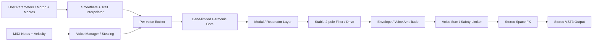

# OMEGA SONIC ORGANISM — Dedicated Technical Blueprint, v1.0

## 1. Product definition

**Product:** OMEGA SONIC ORGANISM (OSO)  
**Maker:** Omega House Studio LLC  
**Format:** VST3 musical instrument, Windows x64 first; 64-bit floating internal summing, initial 32-bit host bus support; add 64-bit sample processing after validation.  
**DAW acceptance host:** FL Studio Producer Edition.  
**MVP:** 5 related yet distinct playable sound families represented by one morphable musical organism—Bass, Bells, Lead, Synth, Percussion—without changing VST3 instances or loading external samples.  
**Business:** standalone sellable instrument; optional future Sonic AI V3 / Omega House OS / Tribal Network interoperability, never mandatory for playback.

### Defensible differentiator
The five families are not a preset list or five parallel rendered channels. They are five **fixed points of one continuous, parameterized DSP manifold**, sharing excitation, spectral, resonant, envelope, and modulation layers. Moving Morph changes those layers' coefficients continuously; musical notes remain connected to the same voice. The sound can cross bass→bell→lead→synth→percussion at any time without retriggering.

**Research honesty:** physical modeling, intelligent sound design, sound morphing, and cross-instance coordination each have precedents. The novel claim is a proposed product-specific synthesis/expression design, not established patent novelty.

## 2. Exact V1 user story
Open one channel in FL Studio, play keyboard or Piano Roll notes, choose or sweep Morph across five timbral identities, change four macros (Energy/Motion/Material/Space), adjust envelope and voice controls on an Advanced page, automate Morph or any principal macro in the DAW, save a project, reopen and hear the same tone. Do not require login, AI, external audio or paid assets.

### Functional acceptance
- Bass: pitched growl/body, glide-capable, velocity-sensitive, clean sub and controllable harmonic grit.
- Bells: pitched inharmonic modal brightness, bright impact with decay, can be sustained/released, distinguishable without being reduced to sampled chimes.
- Lead: stable monophonic/polyphonic harmonic voice, legato articulation, controllable edge.
- Synth: rich harmonic texture and internal motion while remaining MIDI playable.
- Percussion: struck pitch/noise/modal structure, tight onset and decay, responds to MIDI pitch and velocity.
- Interstitial Morph values produce meaningful intermediate timbres, not silence or discontinuities.
- Note events, MIDI velocity, host automation, session state, and offline render must work without GUI open.

## 3. Five identity anchors and DSP profile targets

Morph anchors normalized: `BASS=0.00`, `BELLS=0.25`, `LEAD=0.50`, `SYNTH=0.75`, `PERC=1.00`.

| Profile | Signal family | Envelope A/D/S/R (nominal) | Tonal DNA | Motion logic |
|---|---|---|---|---|
| Bass | sub + band-limited asymmetric harmonic oscillator + pitch drop + saturation | 3 ms / 130 ms / 0.82 / 110 ms | fundamental-dominant, cutoff ~700 Hz, pitch snap 3 semitones / 80 ms | tempo-locked wobble with Energy; mono option |
| Bells | inharmonic resonator/modal bank + hammer impulse | 2 ms / 1550 ms / 0.25 / 1200 ms | inharmonic ratios (e.g. 1, 2.71, 4.08), bright decaying bands, low/no sub | slight detune / beating |
| Lead | band-limited saw/pulse core + filter | 8 ms / 180 ms / 0.72 / 240 ms | prominent midrange, restrained noise | vibrato/portamento |
| Synth | wavetable/spectral harmonic core + moving filter | 30 ms / 600 ms / 0.65 / 650 ms | evolving upper partials, stereo movement | low-frequency phase/filter mod |
| Percussion | transient/noise excitation + tuned short resonators | 1 ms / 220 ms / 0.00 / 130 ms | transient-led, pitched/noise blend | velocity-dependent impact |

These values are **design reference targets**, not claims that the included proof-of-concept sounds exactly like each profile. All anchors remain continuously addressable by host automation.

### Sound generation layout

## 4. Structural morph mathematics

Let five identity profiles be fixed parameter vectors `P0...P4`. For normalized morph `m ∈ [0,1]`:
- `u = 4*m`, `i = min(3, floor(u))`, `t = clamp(u-i,0,1)`.
- Smooth `m` with a bounded one-pole or equivalent ~10–30 ms dezipper (automated modulation should not click).
- Interpolate every trait using a curve appropriate to its domain: amplitude/excitation weights linearly, frequency and time constants logarithmically, spectral tilt and noise energies in a calibrated perceptual domain, bounded inharmonicity linearly.
- Do NOT equal-power crossfade complete processed `P_i` and `P_{i+1}` audio outputs as the primary implementation. One voice uses interpolated traits, oscillator coefficients, envelope times and modal ratios.
- Envelope continuity invariant: never reset a sounding voice's gain envelope merely because the Morph value crossed an anchor. Attack/decay progress remains intact. Changed release coefficient takes effect smoothly.
- If an algorithmic topology must change, keep state warm/continuous, or crossfade the **minimal internal algorithm submodule**, not five complete instrument outputs. Document topology cases.

### Per-voice signal chain (target V1)
1. Common note/velocity/gate/MPE-ready modulation state.
2. Excitation: impulse/soft strike/noise/periodic drive, profiled by identity.
3. Band-limited oscillator: mipmapped wavetable or polyBLEP saw/pulse + sine/sub; band-limited at transposition extremes.
4. Modal layer: at least 4 independently damped partials with interpolated pitch ratios / Q. Clamp resonator poles and filter cutoff below Nyquist margin.
5. Nonlinear layer: drive with 2x oversampling in HQ mode; Eco may use lower-cost saturator with matched gain.
6. Stable morphable filter / resonator + amplitude envelope.
7. Sum and anticlipping protection; gain calibration at each identity anchor and midpoint.
8. Optional local stereo ambience (Space macro); deterministic offline rendering.

### Denormal, alias, click and determinism policy
Flush/substitute extremely small filter states; avoid NaNs and discontinuities at parameter extremes; band-limit oscillators; keep PRNG seed deterministic and local to each voice; render at 44.1, 48, 88.2, 96 and 192 kHz (192k stress only). No quality mode may change stored parameter IDs, plugin CID or MIDI mapping. For the same exact input sequence and host context, render output must be deterministic within a stated floating tolerance.

## 5. Macro mapping (musically meaningful, not decorative)

| Macro | Parameter ID | Semantic behavior |
|---|---:|---|
| MORPH | 100 | Morph coordinate across Bass→Bells→Lead→Synth→Perc; sampled at automation offsets, smoothed to avoid zipper noise. |
| ENERGY | 101 | Correlated drive, filter opening, transient intensity, upper-harmonic weight. Protect low notes against sudden sub loss. |
| MOTION | 102 | Scales vibrato, tremolo, filter modulation and rhythmic wobble **depending on profile**. Zero = stable, one = expressive, never randomized. |
| MATERIAL | 103 | Moves tonal body toward inharmonic/noisy/excited character using frequency-ratio and excitation controls. |
| SPACE | 104 | Dry-to-stereo ambience/wet room send (0 = genuinely dry); room decay and predelay independently bounded. |
| OUTPUT | 105 | Output gain, mapped -24 dB to +6 dB with ramp. |

Additional host controls: attack scale, release scale, glide, polyphony, quality, pitchbend range, LFO sync and LFO rate. All are defined in `contracts/parameters.json`; only flagged controls are automatable. Pitchbend/MIDI mapping support must be validated in FL Studio before making claims.

## 6. Polyphony/voices
- Polyphony 1, 8, 16, 32 voices. Default 16.
- Deterministic steal priority: released quietest voice first, then oldest active voice; apply a short fade to prevent clicks.
- Each note-on creates individual voice phase/noise/envelope state. Velocity shapes gain plus strike intensity, not merely level.
- Note-off enters release stage even for Perc; sustain pedal support in final V1 if host provides CC64 mapping (test actual host).
- Glide is applied to legato notes in mono mode; polyphonic glide disabled or explicit if selected.
- Sustain pedal, duplicate-note handling, all-notes-off and transport reset require dedicated tests.

## 7. Host/platform constraints
- Target Windows x64, FL Studio with stereo VST3 instrument and event input, no audio input in V1. FL instrument channels do not accept ordinary audio sidechain like mixer effects.
- Implement processing/controller separation and VST3 host-persisted state; normal GUI/host parameter automation semantics.
- No background network calls. Neither Sonic AI nor a shop connection may prevent patch loading or audio output.
- Avoid assuming host-provided per-note expression, CC64, or audio routing. Detect actual support and provide automation control fallback.
- Do not advertise sidechain reactive mix intelligence in V1. Future companion effect can expose an audio input on a mixer insert and communicate through a clearly bounded, optional mechanism.

## 8. UI/UX contract
Desktop instrument UI nominal 1040×620 px at 100% scaling; resizable 80–150% where host permits, high DPI aware. Noir-black base, restrained deep-purple interactive highlights, warm gold identity markers; preserve readable labels and colorblind-compatible state indicators.

Layout: header with patch + save/load and status; central 5-node MORPH rail + animated spectral organism; 4 macro rotary controls; lower strip with 5 identity descriptions, polyphony/quality and keyboard/velocity monitor; Advanced tab for envelope/filter/glide/bend. The animation must not block the audio thread; use decimated, lock-free, one-way meter snapshots. Keyboard navigation/tooltips for all controls; text input or fine adjustment for exact values. Every visible control must work and reflect host automation.

## 9. Presets and state
- Factory minimum: 25 carefully programmed presets, 5 per anchor/identity; 5 additional transitional morph presets (30 total). Names describe musical behavior, not exaggerated marketing. All outputs gain matched to avoid destructive peaks.
- Binary VST3 state `magic=OSO1`, `schemaVersion=1`, fixed ordering and explicit lengths/checksum; default missing new fields during migrations.
- `contracts/preset.schema.json` defines human-readable export; JSON import/export is user initiated, never real-time audio-thread work.
- Distinguish saved patch from performance automation. Program change/preset switching must not act as conflicting automated macro changes.
- Factory patches stored as versioned resources, not hardcoded defaults buried in the GUI.

## 10. Roadmap boundary
**V1:** standalone synth only.  
**V1.1:** better wavetable set, per-note expression where host supports it, macro assignment and preset browser improvements.  
**V2:** Negative Space companion **effect** with mixer audio input and optional inter-instance music-state messaging; no mandatory model/cloud.  
**V3:** authorized Sonic AI/Tribal Network sound-pack DNA authoring and metadata workflow. Audio runtime stays local/offline.

## 11. Commercial release definition
Only call version `1.0` release-ready after reproducible Windows x64 build, full validator passing, DAW save/reload/offline-render tests, automation tests, preset migration, noise/alias/denormal checks, 30 patches, packaging/license notices, clean install/uninstall and reproducible session comparisons. See `TEST_RELEASE_GATES.md`.
